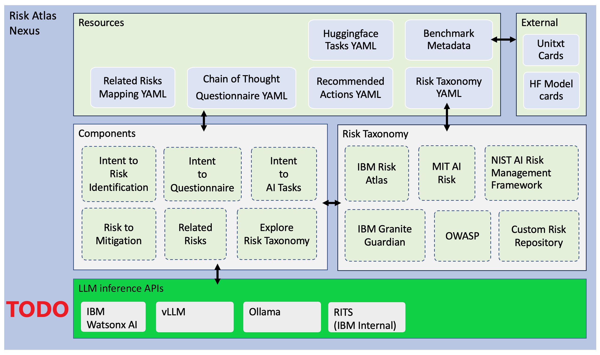

# Architecture

This page explains why AI governance needs a catalogue, what the four doors into AI-LinkMO share, and where the project sits beside IBM AI Atlas Nexus. It is for anyone deciding whether to use AI-LinkMO, and for anyone who adds data or a door to it. [Install](install.md) gets it running.

 **One linked model, four ways in: a risk identifier means the same thing in a terminal, a pipeline, a browser and a graph query.**

  

## Why governance needs a catalogue

AI governance today mostly lives in PDFs and spreadsheets:

- **Frameworks multiply.** NIST AI RMF, the EU AI Act, ISO/IEC 42001, FINOS AIGF, the OWASP LLM Top 10, SR 11-7: each has its own vocabulary for overlapping risks and controls.
- **Mapping is manual.** *Which of our controls satisfy both NIST and the EU AI Act?* Today an analyst answers that with a crosswalk spreadsheet, built by hand, slow to make, and stale the moment a framework updates.
- **Governance and engineering don't share a language.** Compliance teams work in policy clauses; engineers work in pipelines and APIs. Nothing traces a regulatory obligation to a deployed control.

The knowledge already exists; it is in the frameworks. What is missing is the catalogue: one model in which a risk, a control and the clause that requires it are each one record with one identifier. Then the question above is a query rather than a quarter's work, and the answer is the same whoever asks it and however they ask.

## One model, four ways in

AI-LinkMO closes that gap with **one linked data model**, a LinkML ontology of risks, controls, obligations, taxonomies, models, evaluations and incidents, exposed through **four DevSecOps-ready access patterns**. Every stakeholder gets the same single source of truth in the form they can use:

| Access pattern | Who it serves | What you get |
| :--- | :--- | :--- |
| **Command Line Interface (CLI)** | Engineers, CI/CD pipelines | Automation-friendly queries and exports (fastCLI/slowCLI modes) |
| **FastAPI Backend** | System integrators, GRC tools | REST API with one listing per ontology class; its contract is the server's `/openapi.json` |
| **Svelte Web UI** | Risk, compliance and business stakeholders | Point-and-click exploration with persistent identifiers, no coding required |
| **Graph Database (Neo4j)** | Analysts, data scientists | Relationship analysis and regulatory crosswalks as a queryable graph |

Every door is generated from [the same ontology](https://ibm.github.io/ai-atlas-nexus/ontology/): the CLI, the API, the web UI and the schema. That is why a risk identifier means the same thing everywhere, and why the traceability is auditable. The couplet at the top is the shape of the work. *Search out* the frameworks. Show *no favour* among them, with one ontology and one identifier for each thing. *Consult* them against each other, which is what a crosswalk is. *Then act*, from a terminal, a pipeline, a browser or a graph query.

## What it looks like

- *"Show me every risk defined by NIST AI RMF"* → `./ai risk --isDefinedByTaxonomy nist-ai-rmf`
- *"Which controls mitigate toxic output?"* → `./ai control --related --hasRelatedRisk atlas-toxic-output`
- *"Map NIST risks to the FINOS framework"* → `./ai crosswalk --isDefinedByTaxonomy nist-ai-rmf --isDefinedByTaxonomy2 finos-aigf --export --byod`
- *"Add our internal AI policy taxonomy alongside the public ones"* → drop a schema-compliant YAML file into [./byo/data](../byo/data) ([Bring your own data](working-with-the-data.md#bring-your-own-data))
- *"Walk me through all four, with a real incident"* → [byo/notes/EXAMPLES.md](../byo/notes/EXAMPLES.md), a scripted demo that traces a leaked-prompt incident to its risks and controls and ends in a CI gate

The words those commands use, taxonomy, risk, control, obligation, crosswalk, are defined in [docs/key-concepts.md](key-concepts.md). Screenshots of each door are in [byo/images/](../byo/images/).

## Where this sits

AI-LinkMO's family is [IBM AI Atlas Nexus](https://ibm.github.io/ai-atlas-nexus/). Upstream provides the AI Risk Ontology, a [LinkML](https://linkml.io/) schema; the packaged risk data; and the `ai-atlas-nexus` library that loads both. Every door here is generated from that schema. This repository is a workshop that runs over them. It adds doors, encodings and checks, and no ontology of its own. It adds no provenance on the records yet either: nothing says who checked an encoding against the framework's own text. [For the curious](for-the-curious.md#where-this-sits) lists what is added and where, and says why the missing provenance is the auditor's first question.

## Status and caveats

This is a demo. The API, the web UI and the CLI will all be reworked, so treat their shapes as illustrative, and the version stays below 1.0.0 until they settle. Keep it on localhost: the write endpoints are unauthenticated. No encoding under `byo/data/` has been checked by a named person against its framework's text. The full list, including what is thinner than its type suggests and what is slow: [docs/status.md](status.md).

## This repository's own bundle

This repository keeps a LOKF bundle of its own under `.lokf/knowledge/`: documentation about AI-LinkMO, kept the way AI-LinkMO keeps governance data, with one identifier per concept and a source beside every claim. The [knowledge-trust-ladder](https://github.com/noelmcloughlin/knowledge-trust-ladder) skills maintain it on a schedule, it is what the docent answers from, and none of it is part of the product. [CONTRIBUTING.md](../CONTRIBUTING.md#agent-skills-optional---only-for-editing-this-repos-own-lokf-bundle) says which skills editing it takes.

## Read on

| | |
| --- | --- |
| What to install, and how to start the API, the web UI and the CLI | [install.md](install.md) |
| The vocabulary the four doors share: taxonomy, risk, control, obligation, crosswalk, incident, evaluation, BYOD | [key-concepts.md](key-concepts.md) |
| Working with the data: bring your own, crosswalks, search, browsing in Datasette, the schema's pages with examples, the graph export and Neo4j | [working-with-the-data.md](working-with-the-data.md), [neo4j.md](neo4j.md) |
| Every CLI command, by entity type | [cli-examples.md](cli-examples.md) |
| What this adds over AI Atlas Nexus, what it leaves out, where it could go; LLM inference and ARES on your own infrastructure | [for-the-curious.md](for-the-curious.md), [llm-inferencing.md](llm-inferencing.md) |
| Status and caveats, the full list | [status.md](status.md) |
| How releases are cut, and why the version stays below 1.0.0 | [releasing.md](releasing.md), [CHANGELOG.md](../CHANGELOG.md) |
| The repository tree, the three toolchains and the test suite; contributing; reporting a security issue | [repository-layout.md](repository-layout.md), [CONTRIBUTING.md](../CONTRIBUTING.md), [SECURITY.md](../SECURITY.md) |
| The code of conduct and the AI covenant; what to read before running the API outside localhost or enabling the BYOD upload path | [CODE_OF_CONDUCT.md](../CODE_OF_CONDUCT.md), [AI_COVENANT.md](../AI_COVENANT.md), [SECURITY.md](../SECURITY.md) |

## Credits

- [IBM AI Atlas Nexus](https://ibm.github.io/ai-atlas-nexus/): the [AI Risk Ontology](https://ibm.github.io/ai-atlas-nexus/ontology/) and open risk data every access pattern here is generated from, and the `ai-atlas-nexus` package that loads them.
- [FINOS AI Governance Framework](https://air-governance-framework.finos.org/): the first framework encoded under `byo/data/`, and the model for the eight that followed; every framework's authors are listed in [NOTICE](../NOTICE).
- [Nolan Nichols](https://lokf.nolan-nichols.com/), creator of [LOKF](https://lokf.nolan-nichols.com/specification/) (Linked Open Knowledge Format) and its [toolkit](https://github.com/nicholsn/lokf).
- The [LinkML Community](https://linkml.io/), creators of [LinkML](https://linkml.io/linkml/), the schema language that both the AI Risk Ontology and LOKF are written in.
- [knowledge-trust-ladder](https://github.com/noelmcloughlin/knowledge-trust-ladder): the librarian that maintains this repository's own bundle, and the docent in the notice at the top.
- Thiruvalluvar, whose *Tirukkural* has been read on the duties of those who govern for some two thousand years; the couplet at the top is in G.U. Pope's 1886 translation.

## License

Apache-2.0; see [LICENSE](../LICENSE) and [NOTICE](../NOTICE).
